```{r, packages_data_fns}
#| echo: false
#| include: false

#load packages
source("0_set_up.R")
source("R/page_helpers.R")   # tab headers (tab_header)
source("R/codebook.R")       # aa_citation()

#set version
version <- "2025"

# check for updates (uncomment below)
if (Sys.getenv("GITHUB_ACTIONS") != "true") {
  update_aa_data()
  update_aa_graphics()
}

#import data
aa_data <- import(glue("data/aa_data_wide_nogeo_{version}.rds", trust=TRUE))
aa_data_long <- import(glue("data/aa_data_long_nogeo_{version}.rds", trust=TRUE))

```

# Timing

```{r, r_objs_yr}
#| include: false
#| echo: false

#years in dataset
years <- n_distinct(aa_data$year, na.rm = TRUE)

#most recent year
years_max <- max(aa_data$year, na.rm = TRUE)

#average of last five years
mean_last_5yr <- get_mean(aa_data, year, (years_max-4):years_max)

#average of first five years (2000-2004)
mean_first_5yr <- get_mean(aa_data, year, 2000:2004)

#average of second five years (2005-2009)
mean_second_5yr <- get_mean(aa_data, year, 2005:2009)

#April-August % of attacks
warm_months_pct <- get_pct(aa_data, month, month.abb[4:8])

#midday % of attacks
midday_pct <- get_pct(aa_data, hour, 12)

#late morning % of attacks
late_morn_pct <- get_pct(aa_data, hour, 8:11)

#early afternoon % of attacks
early_aft_pct <- get_pct(aa_data, hour, 13:16)

```

## {height="auto"}

::: {.card .aa-head expandable="false"}
```{r}
yr_counts <- count(aa_data, year)
peak     <- yr_counts[which.max(yr_counts$n), ]
tab_header("Timing",
           "When active attacks happened: by year, month, day of the week, and hour of the day.",
           setNames(c(scales::comma(nrow(aa_data)), sum(aa_data$year == years_max, na.rm = TRUE),
                      glue("{peak$year} ({peak$n})")),
                    c(glue("Attacks, 2000\u2013{years_max}"), glue("In {years_max}"), "Peak year")),
           latest = glue("In {years_max}"))
```
:::

## row 1

### {.tabset width="62%"}

::: {.card .flow title="By year" expandable="true"}
::: {.light-content}
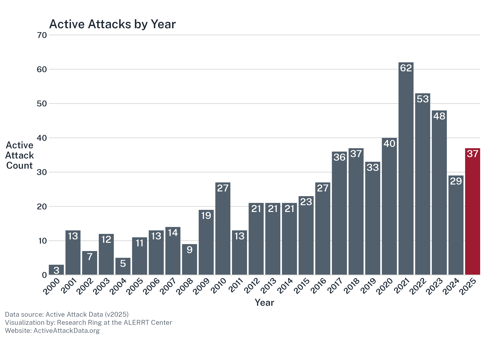{fig-alt="By year"}
:::
::: {.dark-content}
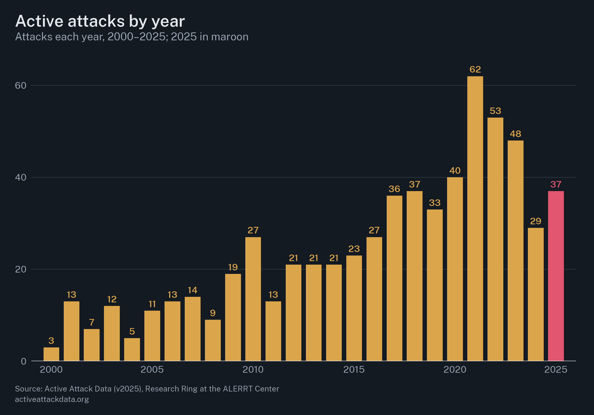{fig-alt="By year"}
:::

::: {.aa-downloads}
<a class="aa-dl light-content" href="www/univar_yr.png" download="aa_by_year.png"><svg viewBox="0 0 24 24" aria-hidden="true"><path d="M12 3v12m0 0 4-4m-4 4-4-4M4 17v3h16v-3"/></svg>Download PNG</a>
<a class="aa-dl dark-content" href="www/dark/univar_yr.png" download="aa_by_year_dark.png"><svg viewBox="0 0 24 24" aria-hidden="true"><path d="M12 3v12m0 0 4-4m-4 4-4-4M4 17v3h16v-3"/></svg>Download PNG</a>
:::
:::

::: {.card .flow title="By month" expandable="true"}
::: {.light-content}
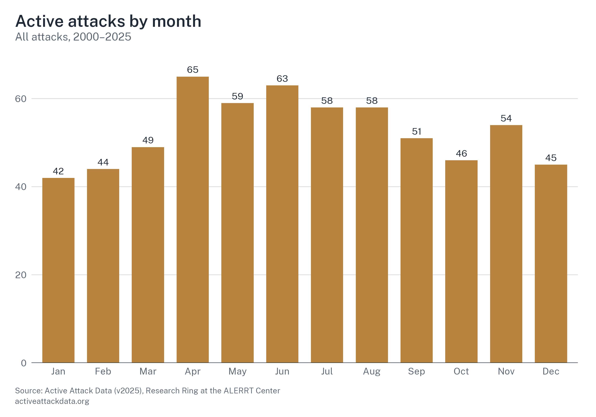{fig-alt="By month"}
:::
::: {.dark-content}
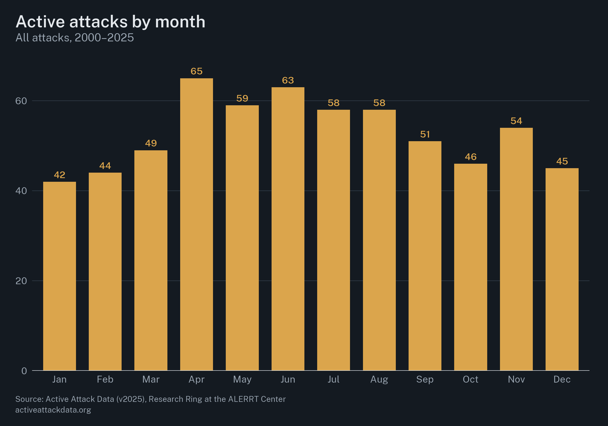{fig-alt="By month"}
:::

::: {.aa-downloads}
<a class="aa-dl light-content" href="www/univar_month.png" download="aa_by_month.png"><svg viewBox="0 0 24 24" aria-hidden="true"><path d="M12 3v12m0 0 4-4m-4 4-4-4M4 17v3h16v-3"/></svg>Download PNG</a>
<a class="aa-dl dark-content" href="www/dark/univar_month.png" download="aa_by_month_dark.png"><svg viewBox="0 0 24 24" aria-hidden="true"><path d="M12 3v12m0 0 4-4m-4 4-4-4M4 17v3h16v-3"/></svg>Download PNG</a>
:::
:::

::: {.card .flow title="By day of the week" expandable="true"}
::: {.light-content}
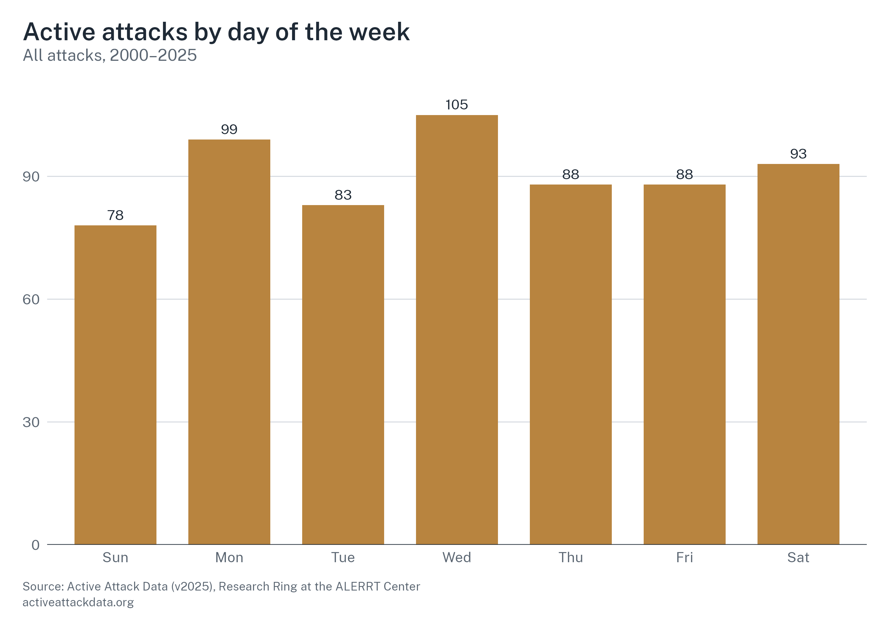{fig-alt="By day of the week"}
:::
::: {.dark-content}
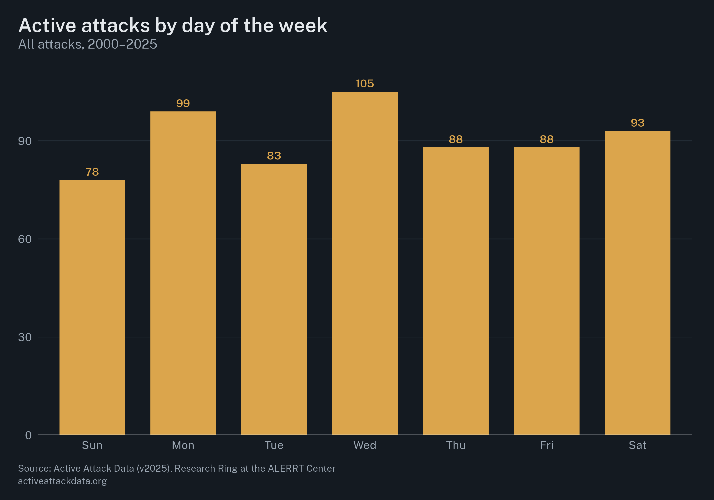{fig-alt="By day of the week"}
:::

::: {.aa-downloads}
<a class="aa-dl light-content" href="www/univar_wday.png" download="aa_by_wday.png"><svg viewBox="0 0 24 24" aria-hidden="true"><path d="M12 3v12m0 0 4-4m-4 4-4-4M4 17v3h16v-3"/></svg>Download PNG</a>
<a class="aa-dl dark-content" href="www/dark/univar_wday.png" download="aa_by_wday_dark.png"><svg viewBox="0 0 24 24" aria-hidden="true"><path d="M12 3v12m0 0 4-4m-4 4-4-4M4 17v3h16v-3"/></svg>Download PNG</a>
:::
:::

::: {.card .flow title="By hour of the day" expandable="true"}
::: {.light-content}
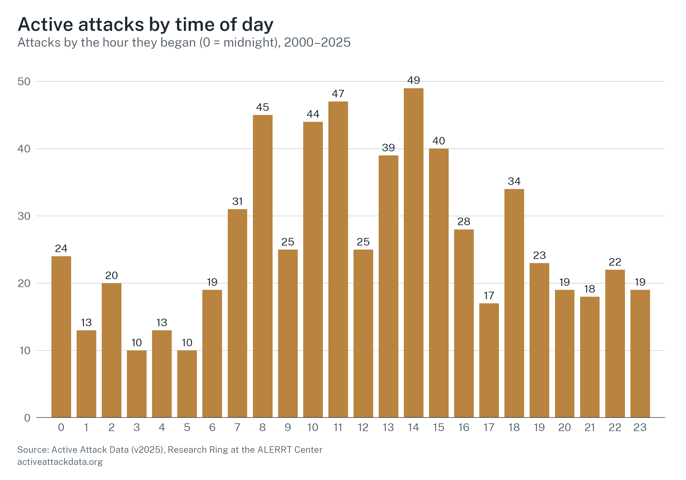{fig-alt="By hour of the day"}
:::
::: {.dark-content}
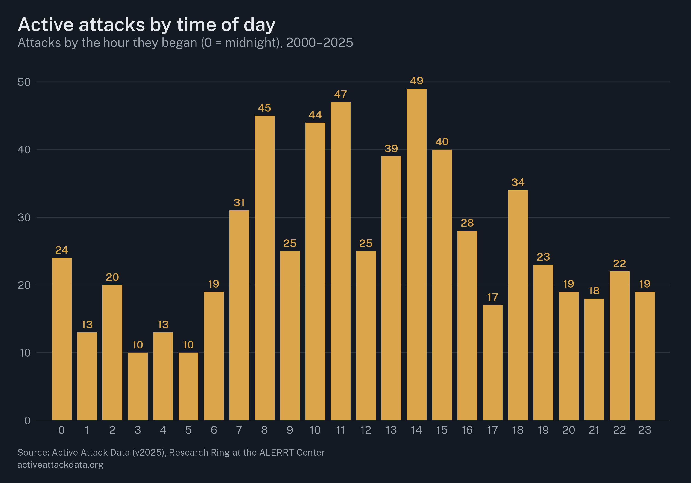{fig-alt="By hour of the day"}
:::

::: {.aa-downloads}
<a class="aa-dl light-content" href="www/univar_hr.png" download="aa_by_hour.png"><svg viewBox="0 0 24 24" aria-hidden="true"><path d="M12 3v12m0 0 4-4m-4 4-4-4M4 17v3h16v-3"/></svg>Download PNG</a>
<a class="aa-dl dark-content" href="www/dark/univar_hr.png" download="aa_by_hour_dark.png"><svg viewBox="0 0 24 24" aria-hidden="true"><path d="M12 3v12m0 0 4-4m-4 4-4-4M4 17v3h16v-3"/></svg>Download PNG</a>
:::
:::

### {width="38%"}

::: {.card .flow .aa-notes title="What the figures show" expandable="false"}
Active attacks occur for a variety of reasons; sometimes they are
planned and other times not. Here, we show the timing of active attacks
from 2000 to `{r} years_max`, a critical element for premeditated
attacks with the goal of maximizing casualties. As the plots
demonstrate, some dimensions of time are more informative than others.

[By year]{.aa-subhead}
There appear to be more events in the last five years (mean =
`{r} mean_last_5yr`) than the first five years (mean =
`{r} mean_first_5yr`) or second five years (mean =
`{r} mean_second_5yr`); however, this may be an artifact of media
coverage. Attacks that occurred during the first part of this data
collection period likely did not get the national coverage that they do
now. Furthermore, technology and search engines have improved
dramatically over the `{r} years` years of this data collection period.

[By month]{.aa-subhead}
In contrast to the obvious upward trend in attacks across years, there
appears to be only a modest trend related to months of the year. Active
attacks tend to peak during the warmer months of the year (e.g., April
through August account for `{r} warm_months_pct`% of attacks), though
this trend is not a strong one. The relationship with temperature is
similar to trends observed for certain types of violent crime (e.g.,
aggravated assault, homicide) that also tend to peak during the warmest
parts of the year.

[By day of the week]{.aa-subhead}
Active attacks share no observable association with day of the week.
This can be seen by the flat distribution of attacks across the week. So
while there may be trends by year and month, attacks appear to be nearly
equally likely on any given day of the week.

[By hour of the day]{.aa-subhead}
Active attacks tend to cluster around midday. While attacks that begin
at midday exactly are relatively infrequent (only `{r} midday_pct`% of
attacks), half of all attacks occur immediately before midday
(8-11am hours account for `{r} late_morn_pct`% of attacks) or after
midday (1-4pm hours account for `{r} early_aft_pct`% of attacks).
:::

# Attackers

```{r}
#| include: false
#| echo: false

#male % of shooters (long data)
male_pct <- get_pct(aa_data_long, sex, "Male")

#male % of shooters
solo_pct <- get_pct(aa_data, offender_count, 1)

#Black % of shooters
black_pct <- get_pct(aa_data_long, race, "African American")

#White % of shooters
white_pct <- get_pct(aa_data_long, race, "Caucasian")

#other known race groups % and unknown race %, of every attacker (unknown stays in
#the denominator, the same as the race chart and the fact sheet)
other_pct <- get_pct(aa_data_long, race, c("Latino", "Asian", "Middle Eastern", "Other"))
unk_race_pct <- round(100 * mean(is.na(aa_data_long$race)), 1)

#minimum age of shooters
age_min <- min(aa_data_long$age, na.rm = TRUE)

#maximum age of shooters
age_max <- max(aa_data_long$age, na.rm = TRUE)

#median age of shooters
age_median <- median(aa_data_long$age, na.rm = TRUE)

#non-gun % of attacks
non_gun_pct <- get_pct(aa_data, weapon_primary, c("Knife", "Vehicle"))

#pistol %
pistol_pct <- get_pct(aa_data, weapon_primary, "Pistol")

#Riffle %
rifle_pct <- get_pct(aa_data, weapon_primary, "Rifle")

#Shotgun %
shotgun_pct <- get_pct(aa_data, weapon_primary, "Shotgun")

```

## {height="auto"}

::: {.card .aa-head expandable="false"}
```{r}
tab_header("Attackers",
           "Who carried out the attacks, and the weapons they used.",
           c("Male" = tile_pct(male_pct), "Acted alone" = tile_pct(solo_pct),
             "Median age" = age_median))
```
:::

## row 1

### {.tabset width="62%"}

::: {.card .flow title="Race and ethnicity" expandable="true"}
::: {.light-content}
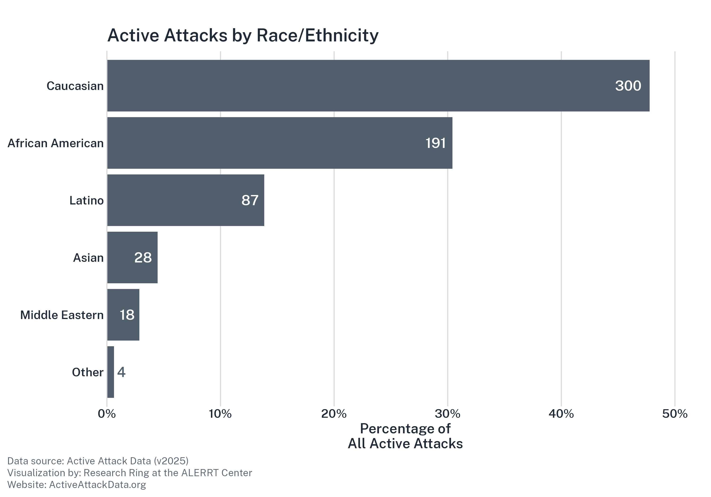{fig-alt="Race and ethnicity"}
:::
::: {.dark-content}
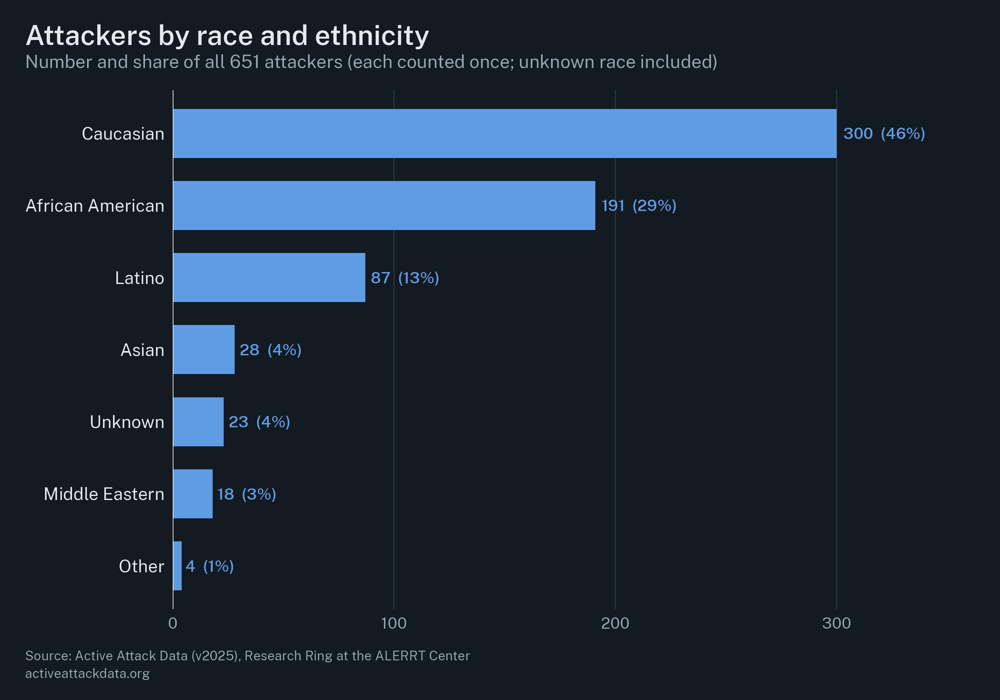{fig-alt="Race and ethnicity"}
:::

::: {.aa-downloads}
<a class="aa-dl light-content" href="www/univar_race.png" download="aa_by_race.png"><svg viewBox="0 0 24 24" aria-hidden="true"><path d="M12 3v12m0 0 4-4m-4 4-4-4M4 17v3h16v-3"/></svg>Download PNG</a>
<a class="aa-dl dark-content" href="www/dark/univar_race.png" download="aa_by_race_dark.png"><svg viewBox="0 0 24 24" aria-hidden="true"><path d="M12 3v12m0 0 4-4m-4 4-4-4M4 17v3h16v-3"/></svg>Download PNG</a>
:::
:::

::: {.card .flow title="Age" expandable="true"}
::: {.light-content}
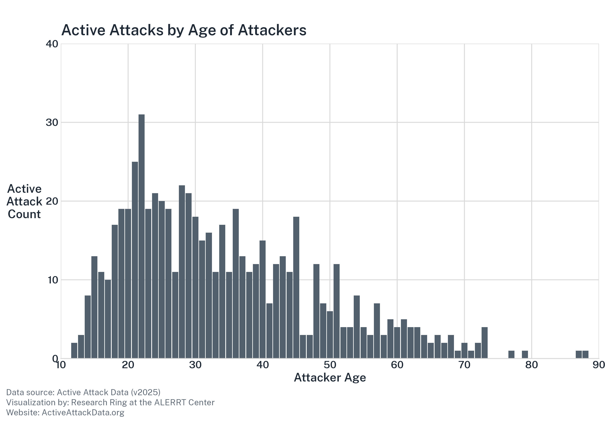{fig-alt="Age"}
:::
::: {.dark-content}
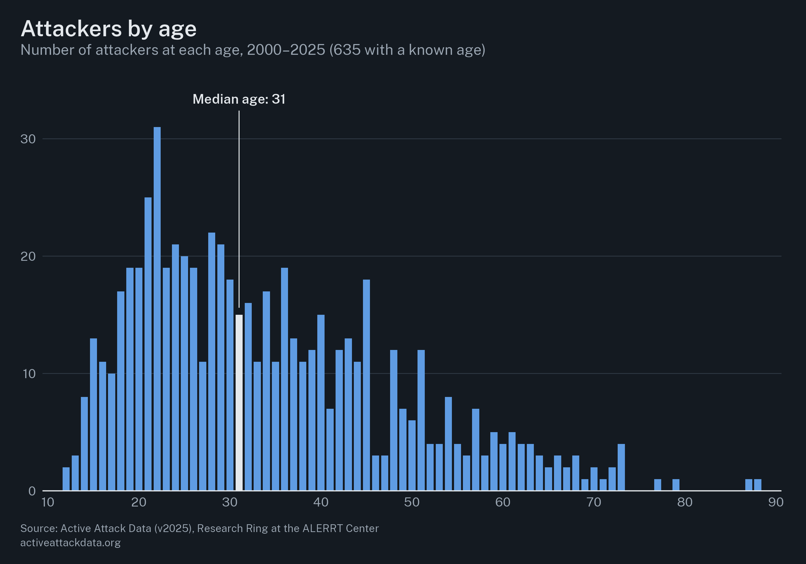{fig-alt="Age"}
:::

::: {.aa-downloads}
<a class="aa-dl light-content" href="www/univar_age.png" download="aa_by_age.png"><svg viewBox="0 0 24 24" aria-hidden="true"><path d="M12 3v12m0 0 4-4m-4 4-4-4M4 17v3h16v-3"/></svg>Download PNG</a>
<a class="aa-dl dark-content" href="www/dark/univar_age.png" download="aa_by_age_dark.png"><svg viewBox="0 0 24 24" aria-hidden="true"><path d="M12 3v12m0 0 4-4m-4 4-4-4M4 17v3h16v-3"/></svg>Download PNG</a>
:::
:::

::: {.card .flow title="Weapon" expandable="true"}
::: {.light-content}
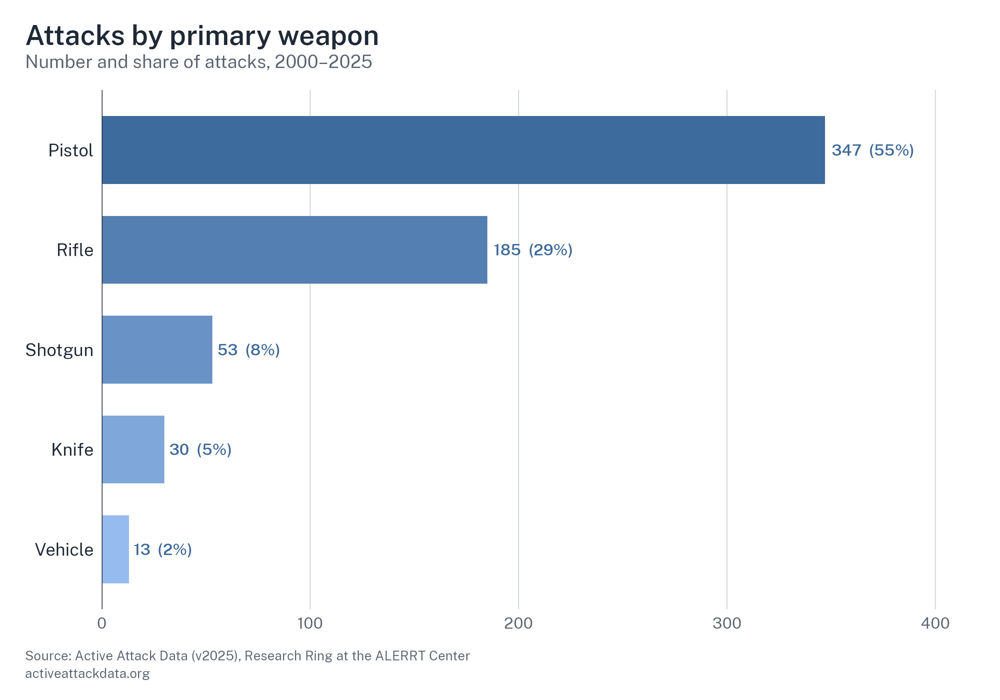{fig-alt="Weapon"}
:::
::: {.dark-content}
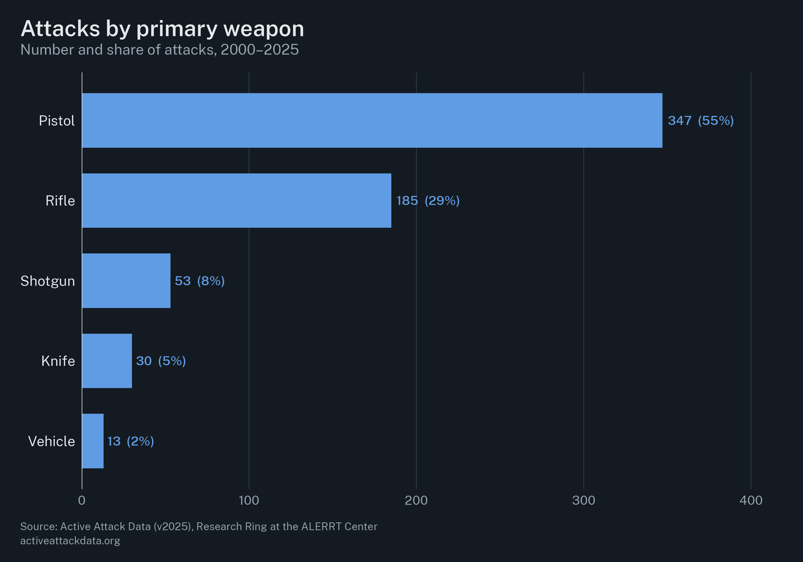{fig-alt="Weapon"}
:::

::: {.aa-downloads}
<a class="aa-dl light-content" href="www/univar_weapon.png" download="aa_by_weapon.png"><svg viewBox="0 0 24 24" aria-hidden="true"><path d="M12 3v12m0 0 4-4m-4 4-4-4M4 17v3h16v-3"/></svg>Download PNG</a>
<a class="aa-dl dark-content" href="www/dark/univar_weapon.png" download="aa_by_weapon_dark.png"><svg viewBox="0 0 24 24" aria-hidden="true"><path d="M12 3v12m0 0 4-4m-4 4-4-4M4 17v3h16v-3"/></svg>Download PNG</a>
:::
:::

### {width="38%"}

::: {.card .flow .aa-notes title="What the figures show" expandable="false"}
Many in the media attempt to create a profile describing the “average”
attacker. The data do not support a profile beyond sex and number of
attackers. Attackers were male `{r} male_pct`% of the time. Furthermore,
the attacker commits the attack alone `{r} solo_pct`% of the
time. Beyond these characteristics, attackers are somewhat more varied.

[Race and ethnicity]{.aa-subhead}
Most attackers were either Caucasian
(`{r} white_pct`%) or African American (`{r} black_pct`%). All other
racial/ethnic groups (e.g., Latino, Asian, Middle Eastern) accounted
for `{r} other_pct`% of attackers, and race was unknown for
`{r} unk_race_pct`%.

[Age]{.aa-subhead}
While the median age of attackers was `{r} age_median` years old,
attackers ranged in age from `{r} age_min` to `{r} age_max`. Attackers
in their twenties were the most plentiful group compared to any other
decade of life. The age-trend of attackers adheres to the classic
"age-crime curve" observed for nearly every crime type, peaking in late
adolescence/early adulthood and steadily declining throughout the rest
of the life course.

[Weapon]{.aa-subhead}
Active attacks can be carried out using any weapon though, in reality,
only a very small minority of attacks (`{r} non_gun_pct`%) were carried
out using weapons other than firearms (e.g., knife, vehicle). Among
firearms, pistols were the most common, used in `{r} pistol_pct`% of
all attacks, while rifles (e.g., AR15s) and shotguns were used in
`{r} rifle_pct`% and `{r} shotgun_pct`% of all attacks, respectively.
:::

# Locations

```{r, r_objs_loc}
#| include: false
#| echo: false

#LOCATION TYPE

# Business %
business_pct <- get_pct(aa_data, location_primary, c("Office", "Factory/warehouse", "Retail", "Medical facility"))

# outdoor %
outdoors_pct <- get_pct(aa_data, location_primary, "Outdoors")

# School %
school_pct <- get_pct(aa_data, location_primary, "School")

# Other %
other_pct <- get_pct(aa_data, location_primary, c("Other", "Church", "Military base"))

#get n's
# Business n
business_n <- get_count(aa_data, location_primary, c("Office", "Factory/warehouse", "Retail", "Medical facility"))

# outdoor n
outdoors_n <- get_count(aa_data, location_primary, "Outdoors")

# School n
school_n <- get_count(aa_data, location_primary, "School")

# Other n
other_n <- get_count(aa_data, location_primary, c("Other", "Church", "Military base"))

#RELATIONSHIP TO LOC

# no relationship %
norel_pct <- get_pct(aa_data, relationship, "No relationship")

# coworker %
coworker_pct <- get_pct(aa_data, relationship, "Coworker")

# other %
other_rel_pct <- get_pct(aa_data, relationship, "Other")

# indirect %
indirect_pct <- get_pct(aa_data, relationship, "Indirect")

# student n
student_pct <- get_pct(aa_data, relationship, "Student")

# student n
student_n <- get_count(aa_data, relationship, "Student")


#relationship by location type
#school
school_student_pct <- get_pct(aa_data |> filter(location_primary=="School"), relationship, "Student")
school_other_pct <- get_pct(aa_data |> filter(location_primary=="School"), relationship, "Other")
school_coworker_pct <- get_pct(aa_data |> filter(location_primary=="School"), relationship, "Coworker")
school_norel_pct <- get_pct(aa_data |> filter(location_primary=="School"), relationship, "No relationship")

#business
business_coworker_pct <- get_pct(
  aa_data |> filter(location_primary %in% c("Office", "Factory/warehouse", "Retail", "Medical facility")),
  relationship, 
  "Coworker")

```

## {height="auto"}

::: {.card .aa-head expandable="false"}
```{r}
tab_header("Locations",
           "Where attacks happened, and the attacker's relationship to the place.",
           c("At a business" = tile_pct(business_pct), "At a school" = tile_pct(school_pct),
             "No relationship to the place" = tile_pct(norel_pct)))
```
:::

## row 1

### {.tabset width="62%"}

::: {.card .flow title="Location type" expandable="false"}
::: {.light-content}
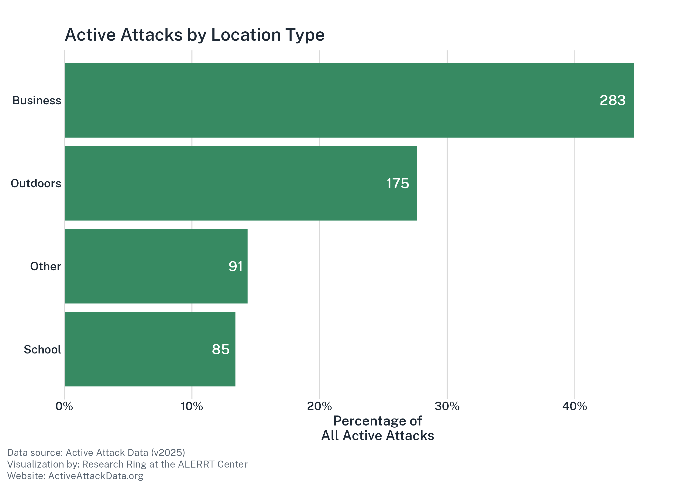{fig-alt="Location type"}
:::
::: {.dark-content}
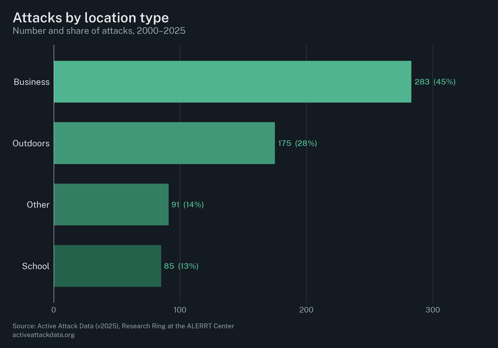{fig-alt="Location type"}
:::

::: {.aa-downloads}
<a class="aa-dl light-content" href="www/univar_loc.png" download="aa_by_loc_type.png"><svg viewBox="0 0 24 24" aria-hidden="true"><path d="M12 3v12m0 0 4-4m-4 4-4-4M4 17v3h16v-3"/></svg>Download PNG</a>
<a class="aa-dl dark-content" href="www/dark/univar_loc.png" download="aa_by_loc_type_dark.png"><svg viewBox="0 0 24 24" aria-hidden="true"><path d="M12 3v12m0 0 4-4m-4 4-4-4M4 17v3h16v-3"/></svg>Download PNG</a>
:::
:::

::: {.card .flow title="Relationship to the location" expandable="true"}
::: {.light-content}
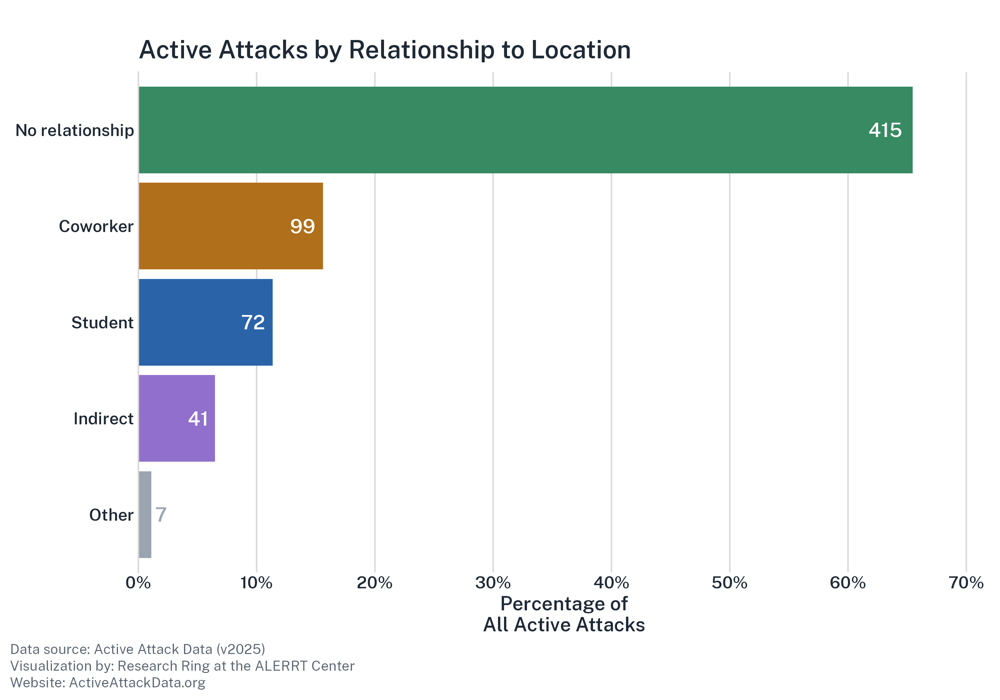{fig-alt="Relationship to the location"}
:::
::: {.dark-content}
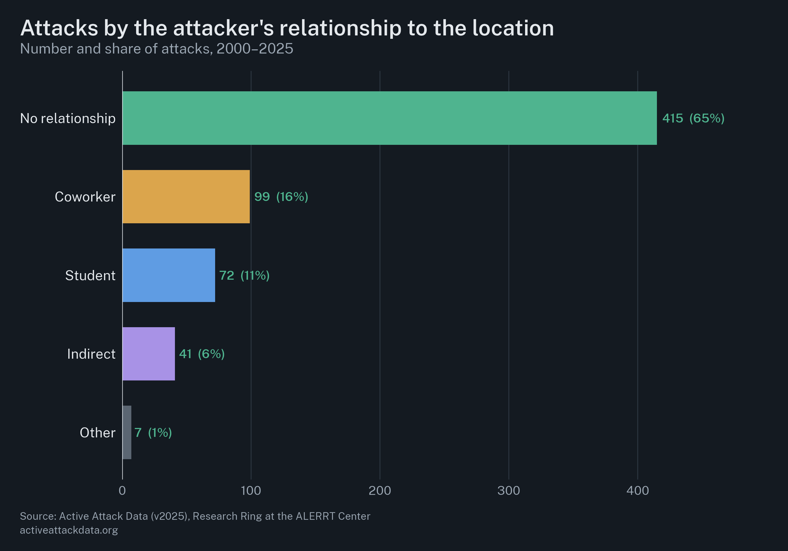{fig-alt="Relationship to the location"}
:::

::: {.aa-downloads}
<a class="aa-dl light-content" href="www/univar_rel.png" download="aa_by_rel_type.png"><svg viewBox="0 0 24 24" aria-hidden="true"><path d="M12 3v12m0 0 4-4m-4 4-4-4M4 17v3h16v-3"/></svg>Download PNG</a>
<a class="aa-dl dark-content" href="www/dark/univar_rel.png" download="aa_by_rel_type_dark.png"><svg viewBox="0 0 24 24" aria-hidden="true"><path d="M12 3v12m0 0 4-4m-4 4-4-4M4 17v3h16v-3"/></svg>Download PNG</a>
:::
:::

::: {.card .flow title="Relationship by location type" expandable="true"}
::: {.light-content}
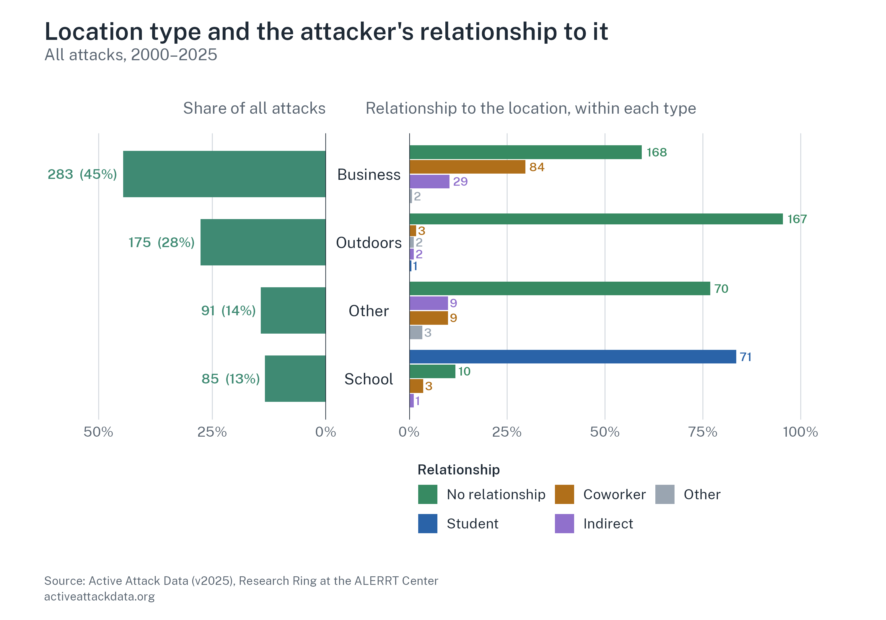{fig-alt="Relationship by location type"}
:::
::: {.dark-content}
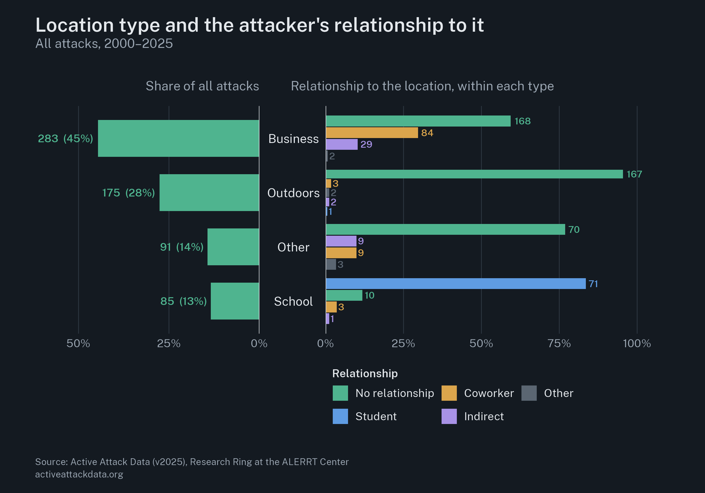{fig-alt="Relationship by location type"}
:::

::: {.aa-downloads}
<a class="aa-dl light-content" href="www/bivar_loctype_rel.png" download="aa_rel_loctype.png"><svg viewBox="0 0 24 24" aria-hidden="true"><path d="M12 3v12m0 0 4-4m-4 4-4-4M4 17v3h16v-3"/></svg>Download PNG</a>
<a class="aa-dl dark-content" href="www/dark/bivar_loctype_rel.png" download="aa_rel_loctype_dark.png"><svg viewBox="0 0 24 24" aria-hidden="true"><path d="M12 3v12m0 0 4-4m-4 4-4-4M4 17v3h16v-3"/></svg>Download PNG</a>
:::
:::

::: {.card .flow title="Time of day by location type" expandable="true"}
::: {.light-content}
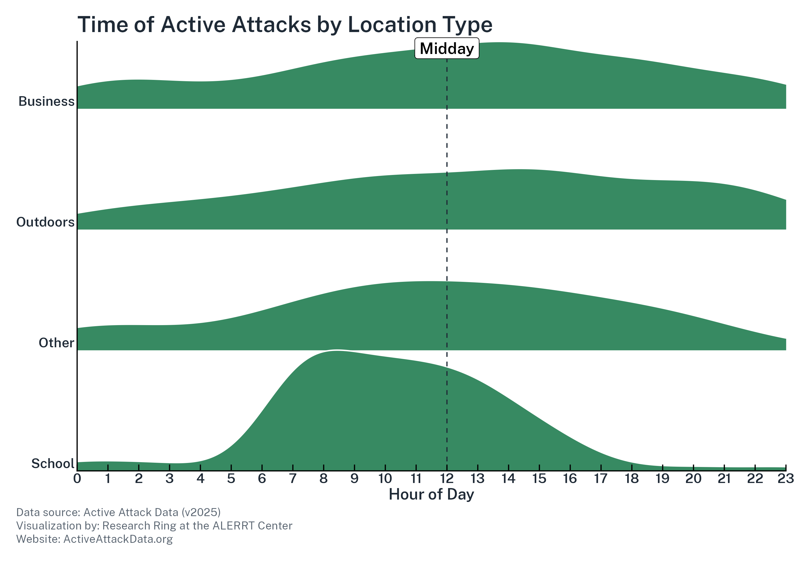{fig-alt="Time of day by location type"}
:::
::: {.dark-content}
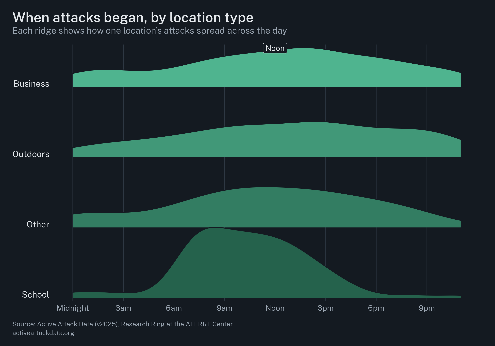{fig-alt="Time of day by location type"}
:::

::: {.aa-downloads}
<a class="aa-dl light-content" href="www/bivar_loc_hr.png" download="aa_hour_by_log_type.png"><svg viewBox="0 0 24 24" aria-hidden="true"><path d="M12 3v12m0 0 4-4m-4 4-4-4M4 17v3h16v-3"/></svg>Download PNG</a>
<a class="aa-dl dark-content" href="www/dark/bivar_loc_hr.png" download="aa_hour_by_log_type_dark.png"><svg viewBox="0 0 24 24" aria-hidden="true"><path d="M12 3v12m0 0 4-4m-4 4-4-4M4 17v3h16v-3"/></svg>Download PNG</a>
:::
:::

### {width="38%"}

::: {.card .flow .aa-notes title="What the figures show" expandable="false"}
Defining where an attack occurred can be difficult. For instance, on
January 8, 2011, a shooter attacked a meeting for U.S. Representative
Gabrielle Giffords. This attack happened in the parking lot of a local
Tucson grocery store. Had the attack happened in the store, it would have
been classified as a business event; however, since the attack occurred
in the parking lot it is coded as an outdoor event. Bear these fine
distinctions in mind when examining the visualizations in this section.

[Location type]{.aa-subhead}
As seen here, the plurality of events happen at places of business
(`{r} business_n` attacks; `{r} business_pct`%). Places of business
include retail locations, factories/warehouses, office space, and
medical facilities (e.g., hospitals). Around a quarter of attacks
(`{r} outdoors_pct`%) happened in public (outdoor) spaces. Schools were
attacked `{r} school_n` times (`{r} school_pct`%). These events are
aggregated and include attacks on all types of educational facilities,
including K-12 and institutions of higher education. Lastly, `{r} other_n`
attacks (`{r} other_pct`%) happened at "Other" locations (e.g., houses
of worship, government buildings, residences, and military bases).

[Relationship to the location]{.aa-subhead}
In a vast majority of attacks (`{r} norel_pct`% of all attacks), the
attacker(s) had no prior association with the attack location. For
attackers with some relationship to the location, former/current
employees (`{r} coworker_pct`%) and students (`{r} student_pct`%) were
the most common relationship types, followed by indirect associations
(`{r} indirect_pct`%; e.g., the attacker's wife was associated with the
location) and "other" associations (`{r} other_rel_pct`%).

[Relationship by location type]{.aa-subhead}
When looking within location types, we find that most attackers had no
relationship to the locations. Going beyond attackers with no
relationship, we find some interesting patterns. Despite making up only
`{r} coworker_pct`% of attackers generally, attackers of businesses were
current/former employees `{r} business_coworker_pct`% of the time. A
similar trend is observable in schools, though in this case, the vast
majority of attackers were current/former students
(`{r} school_student_pct`%). Only a small percentage of attacks on
schools (`{r} school_norel_pct`%) were perpetrated by an attacker with
no relationship to the school.

[Time of day by location type]{.aa-subhead}
When grouped by location type, the tendency of attacks to occur around
midday is still observable, though it is modest. The most noticeable
trend can be seen with attacks at schools, where there is a strong
tendency for attacks to occur during the morning hours prior to midday.
Note: this plot shows the density of attacks *within* location types,
meaning that the concentration of attacks is relative to other attacks
within the same location type and *not* to concentrations displayed for
other location types.
:::

# Casualties

```{r, r_objs_vic}
#| include: false
#| echo: false

#get overall totals
casualty_tot <- get_total(aa_data, c(wound_tot,kill_tot))
kill_tot <- get_total(aa_data, kill_tot)
wound_tot <- get_total(aa_data, wound_tot)

#get totals for specific attacks
virginia_tech_kill_tot <- aa_data |> filter(case_code==68)  |> pull(kill_tot)
fort_hood_kill_tot     <- aa_data |> filter(case_code==101) |> pull(kill_tot)
sandy_hook_kill_tot  <- aa_data |> filter(case_code==165) |> pull(kill_tot)
las_vegas_kill_tot    <- aa_data |> filter(case_code==282) |> pull(kill_tot)

virginia_tech_wound_tot <- aa_data |> filter(case_code==68)  |> pull(wound_tot)
fort_hood_wound_tot     <- aa_data |> filter(case_code==101) |> pull(wound_tot)
sandy_hook_wound_tot    <- aa_data |> filter(case_code==165) |> pull(wound_tot)
las_vegas_wound_tot     <- aa_data |> filter(case_code==282) |> pull(wound_tot)

#get totals for specific years (of specific attacks)
kill_2007_total <- get_total(aa_data |> filter(year==2007), kill_tot)
kill_2009_total <- get_total(aa_data |> filter(year==2009), kill_tot)
kill_2012_total <- get_total(aa_data |> filter(year==2012), kill_tot)
kill_2017_total <- get_total(aa_data |> filter(year==2017), kill_tot)

#get yearly percents accounted for by each attack
virginia_tech_kill_tot_pct <- round((virginia_tech_kill_tot/kill_2007_total)*100, 1)
fort_hood_kill_tot_pct     <- round((fort_hood_kill_tot    /kill_2009_total)*100, 1)
sandy_hook_kill_tot_pct    <- round((sandy_hook_kill_tot   /kill_2012_total)*100, 1)
las_vegas_kill_tot_pct     <- round((las_vegas_kill_tot    /kill_2017_total)*100, 1)

#percent death ranges
deaths_0_pct <- get_pct(aa_data |> 
                         mutate(death_0 = ifelse(kill_tot==0, 1, 0)),
                       death_0, 1)
deaths_1to10_pct <- get_pct(aa_data |> 
                         mutate(death_1to10 = ifelse(kill_tot %in% 1:10, 1, 0)),
                       death_1to10, 1)
deaths_lt10_pct <- get_pct(aa_data |> 
                         mutate(death_lt10 = ifelse(kill_tot < 10, 1, 0)),
                       death_lt10, 1)

#percent wounded ranges
casualty_lt10_pct <- get_pct(aa_data |> 
                         mutate(wound_lt10 = ifelse((wound_tot+kill_tot)<10, 1, 0)),
                       wound_lt10, 1)

```

## {height="auto"}

::: {.card .aa-head expandable="false"}
```{r}
tab_header("Casualties",
           "People killed and wounded: by year, in each attack, and by weapon.",
           c("Killed" = format_num(kill_tot), "Wounded" = format_num(wound_tot),
             "Attacks with no deaths" = tile_pct(deaths_0_pct)))
```
:::

## row 1

### {.tabset width="62%"}

::: {.card .flow title="Attacks and casualties by year" expandable="true"}
::: {.light-content}
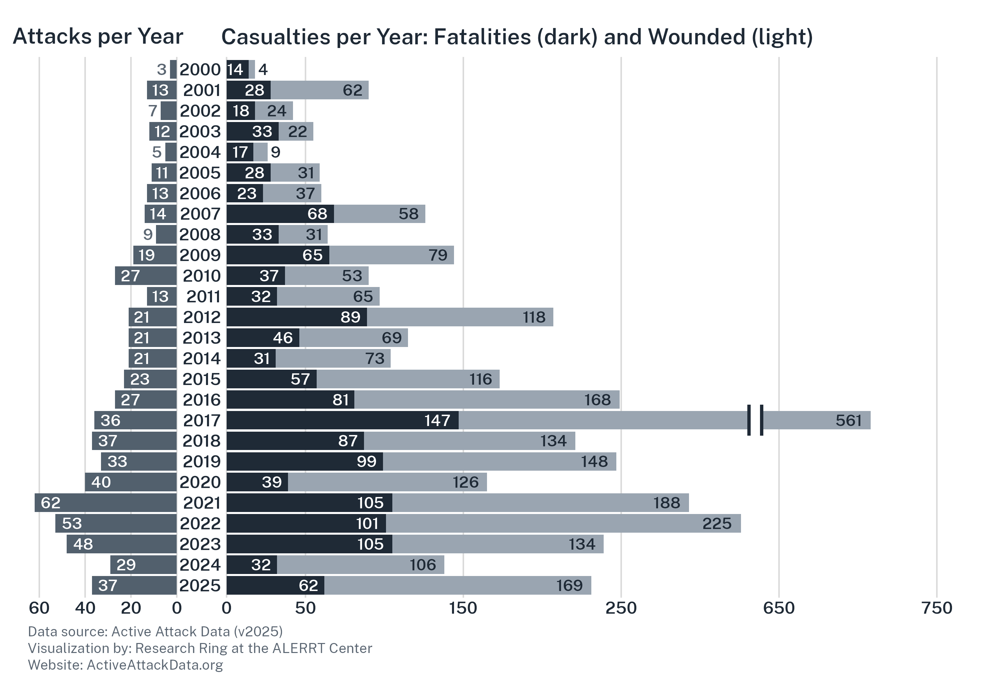{fig-alt="Attacks and casualties by year"}
:::
::: {.dark-content}
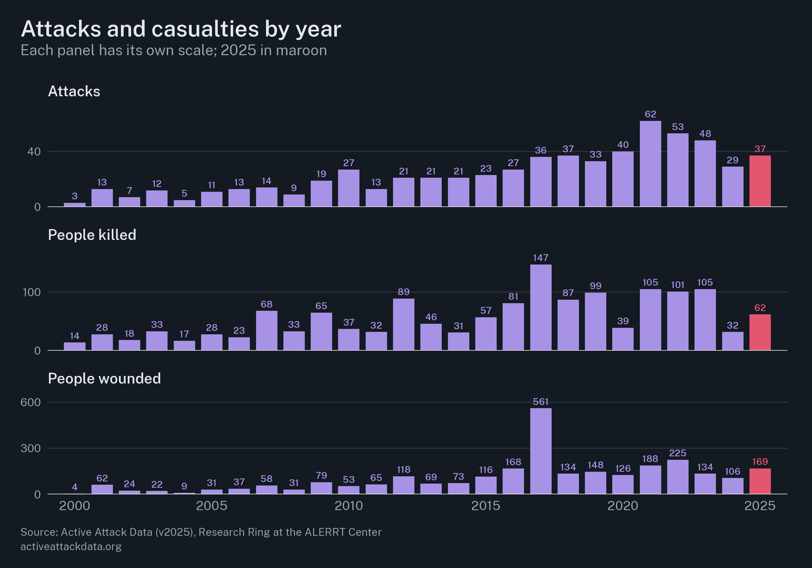{fig-alt="Attacks and casualties by year"}
:::

::: {.aa-downloads}
<a class="aa-dl light-content" href="www/bivar_eventkilled.png" download="attack_killed_year.png"><svg viewBox="0 0 24 24" aria-hidden="true"><path d="M12 3v12m0 0 4-4m-4 4-4-4M4 17v3h16v-3"/></svg>Download PNG</a>
<a class="aa-dl dark-content" href="www/dark/bivar_eventkilled.png" download="attack_killed_year_dark.png"><svg viewBox="0 0 24 24" aria-hidden="true"><path d="M12 3v12m0 0 4-4m-4 4-4-4M4 17v3h16v-3"/></svg>Download PNG</a>
:::
:::

::: {.card .flow title="Wounded and killed per attack" expandable="true"}
<iframe class="aa-widget light-content" src="www/bivar_wound_kill.html" title="Interactive plot" scrolling="no" loading="lazy"></iframe>
<iframe class="aa-widget dark-content" src="www/dark/bivar_wound_kill.html" title="Interactive plot" scrolling="no" loading="lazy"></iframe>

::: {.aa-downloads}
<a class="aa-dl light-content" href="www/bivar_wound_kill.png" download="wounded_fatalities_year.png"><svg viewBox="0 0 24 24" aria-hidden="true"><path d="M12 3v12m0 0 4-4m-4 4-4-4M4 17v3h16v-3"/></svg>Download PNG</a>
<a class="aa-dl dark-content" href="www/dark/bivar_wound_kill.png" download="wounded_fatalities_year_dark.png"><svg viewBox="0 0 24 24" aria-hidden="true"><path d="M12 3v12m0 0 4-4m-4 4-4-4M4 17v3h16v-3"/></svg>Download PNG</a>
<a class="aa-dl light-content" href="www/bivar_wound_kill.html" download="wounded_fatalities_year.html"><svg viewBox="0 0 24 24" aria-hidden="true"><path d="M12 3v12m0 0 4-4m-4 4-4-4M4 17v3h16v-3"/></svg>Download interactive (HTML)</a>
<a class="aa-dl dark-content" href="www/dark/bivar_wound_kill.html" download="wounded_fatalities_year_dark.html"><svg viewBox="0 0 24 24" aria-hidden="true"><path d="M12 3v12m0 0 4-4m-4 4-4-4M4 17v3h16v-3"/></svg>Download interactive (HTML)</a>
:::
:::

::: {.card .flow title="Wounded and killed by weapon" expandable="true"}
<iframe class="aa-widget light-content" src="www/bivar_kill_weapon.html" title="Interactive plot" scrolling="no" loading="lazy"></iframe>
<iframe class="aa-widget dark-content" src="www/dark/bivar_kill_weapon.html" title="Interactive plot" scrolling="no" loading="lazy"></iframe>

::: {.aa-downloads}
<a class="aa-dl light-content" href="www/bivar_kill_weapon.png" download="fatalities_weapon_type.png"><svg viewBox="0 0 24 24" aria-hidden="true"><path d="M12 3v12m0 0 4-4m-4 4-4-4M4 17v3h16v-3"/></svg>Download PNG</a>
<a class="aa-dl dark-content" href="www/dark/bivar_kill_weapon.png" download="fatalities_weapon_type_dark.png"><svg viewBox="0 0 24 24" aria-hidden="true"><path d="M12 3v12m0 0 4-4m-4 4-4-4M4 17v3h16v-3"/></svg>Download PNG</a>
<a class="aa-dl light-content" href="www/bivar_kill_weapon.html" download="fatalities_weapon_type.html"><svg viewBox="0 0 24 24" aria-hidden="true"><path d="M12 3v12m0 0 4-4m-4 4-4-4M4 17v3h16v-3"/></svg>Download interactive (HTML)</a>
<a class="aa-dl dark-content" href="www/dark/bivar_kill_weapon.html" download="fatalities_weapon_type_dark.html"><svg viewBox="0 0 24 24" aria-hidden="true"><path d="M12 3v12m0 0 4-4m-4 4-4-4M4 17v3h16v-3"/></svg>Download interactive (HTML)</a>
:::
:::

### {width="38%"}

::: {.card .flow .aa-notes title="What the figures show" expandable="false"}
There were `{r} format_num(casualty_tot)` casualties from active attacks
between 2000 and `{r} years_max`. Of these, `{r} format_num(kill_tot)`
people died. The visualizations in this section examine the casualties
of active attacks.

[Attacks and casualties by year]{.aa-subhead}
Attacks and total casualties (fatalities and wounded) have been
increasing over the course of data collection (2000-`{r} years_max`).
For specific years, however, there are noticeable spikes in the number
of deaths. These spikes often correspond to some of the more well-known
attacks. For example:

-   **2007**: The attack on Apr. 16th at Virginia Tech, Virginia,
    resulted in `{r} virginia_tech_kill_tot` deaths, accounting for
    `{r} virginia_tech_kill_tot_pct`% of all deaths that year.
-   **2009**: The attack on Nov. 5th at Fort Hood (now Fort Cavazos),
    Texas, resulted in `{r} fort_hood_kill_tot` deaths, accounting for
    `{r} fort_hood_kill_tot_pct`% of all deaths that year.
-   **2012**: The school shooting on Dec. 14th at Sandy Hook Elementary
    School, Connecticut, resulted in `{r} sandy_hook_kill_tot` deaths,
    accounting for `{r} sandy_hook_kill_tot_pct`% of all deaths that
    year.
-   **2017**: The attack on Oct. 1st in Las Vegas, Nevada, resulted in
    `{r} las_vegas_kill_tot` deaths, accounting for
    `{r} las_vegas_kill_tot_pct`% of all deaths that year.

Of note, while the number of active attacks did not decrease during the
COVID-19 pandemic, the lethality of attacks in 2020 decreased to less
than half the number of any of the four years previous. In 2021,
however, the number of attacks increased and the number of deaths
returned to pre-pandemic levels.

[Wounded and killed per attack]{.aa-subhead}
Most attacks (`{r} casualty_lt10_pct`%) resulted in fewer than 10
casualties (killed and/or wounded) and `{r} deaths_0_pct`% of attacks
resulted in no deaths at all. Hover over the points on this plot to get
information about that specific attack. Note: hovering over a point on
one side of the plot will highlight a corresponding point on the other
side.

[Wounded and killed by weapon]{.aa-subhead}
Most attacks (`{r} pistol_pct`% of all attacks) were committed using
pistols. Among these, total fatalities were generally less than 20
(except for the attack at Virginia Tech, 2007). Similarly, nearly all
pistol attacks resulted in \<20 wounded (except the attack at Fort Hood,
2009). Rifle attacks accounted for
`{r} sum(aa_data$kill_tot > 20 & aa_data$weapon_primary %in% "Rifle")`
of the `{r} sum(aa_data$kill_tot > 20)` attacks that surpassed 20
deaths. However, a mix of vehicle and rifle attacks accounted for nearly
all attacks with more than 20 wounded. Hover over the points on this
plot to get information about that specific attack.
:::

# Across the USA

```{r}
#| include: false
#| echo: false

#number of states represented
states_n <- aa_data |> 
  distinct(state) |> 
  filter(state!="DC") |> 
  nrow()

#states with no attacks
states_miss <- tibble(abb = state.abb,
       name = state.name) |> 
  filter(!abb %in% aa_data$state) |> 
  pull(name) |>
  oxford_collapse()
  
```

## {height="auto"}

::: {.card .aa-head expandable="false"}
```{r}
top_st    <- count(aa_data, state, sort = TRUE)[1, ]
top_name  <- if (top_st$state == "DC") "DC" else state.name[match(top_st$state, state.abb)]
tab_header("Across the USA",
           "Where attacks happened across the states.",
           c("States with an attack" = glue("{states_n} and DC"),
             "Most attacks" = glue("{top_name} ({top_st$n})")))
```
:::

## row 1

### {.tabset width="62%"}

::: {.card .flow title="Attacks and fatalities by state" expandable="true"}
<iframe class="aa-widget light-content" src="www/bicol_map_attackxkilled.html" title="Interactive plot" scrolling="no" loading="lazy"></iframe>
<iframe class="aa-widget dark-content" src="www/dark/bicol_map_attackxkilled.html" title="Interactive plot" scrolling="no" loading="lazy"></iframe>

::: {.aa-downloads}
<a class="aa-dl light-content" href="www/bicol_map_attackxkilled.png" download="aa_attack_fatalities_map.png"><svg viewBox="0 0 24 24" aria-hidden="true"><path d="M12 3v12m0 0 4-4m-4 4-4-4M4 17v3h16v-3"/></svg>Download PNG</a>
<a class="aa-dl dark-content" href="www/dark/bicol_map_attackxkilled.png" download="aa_attack_fatalities_map_dark.png"><svg viewBox="0 0 24 24" aria-hidden="true"><path d="M12 3v12m0 0 4-4m-4 4-4-4M4 17v3h16v-3"/></svg>Download PNG</a>
<a class="aa-dl light-content" href="www/bicol_map_attackxkilled.html" download="aa_attack_fatalities_map.html"><svg viewBox="0 0 24 24" aria-hidden="true"><path d="M12 3v12m0 0 4-4m-4 4-4-4M4 17v3h16v-3"/></svg>Download interactive (HTML)</a>
<a class="aa-dl dark-content" href="www/dark/bicol_map_attackxkilled.html" download="aa_attack_fatalities_map_dark.html"><svg viewBox="0 0 24 24" aria-hidden="true"><path d="M12 3v12m0 0 4-4m-4 4-4-4M4 17v3h16v-3"/></svg>Download interactive (HTML)</a>
:::
:::

::: {.card .flow title="Attacks by year (animation)" expandable="true"}
::: {.light-content}
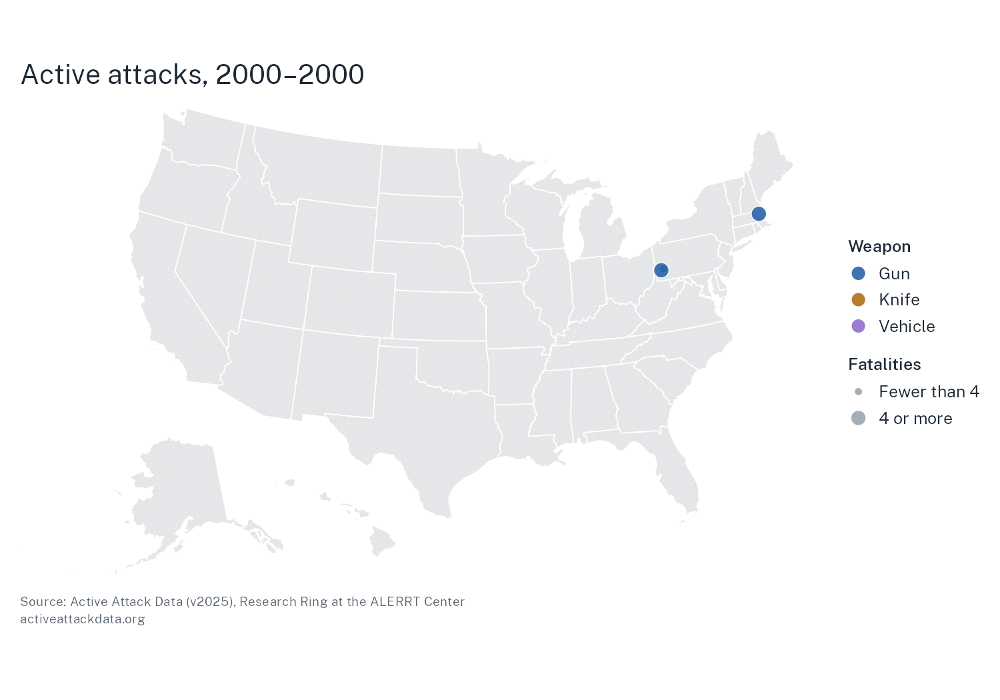{fig-alt="Attacks by year (animation)"}
:::
::: {.dark-content}
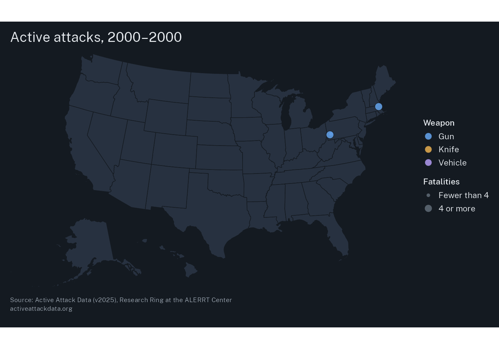{fig-alt="Attacks by year (animation)"}
:::

::: {.aa-downloads}
<a class="aa-dl light-content" href="www/rolling_map.gif" download="aa_attacks_year_map.gif"><svg viewBox="0 0 24 24" aria-hidden="true"><path d="M12 3v12m0 0 4-4m-4 4-4-4M4 17v3h16v-3"/></svg>Download GIF</a>
<a class="aa-dl dark-content" href="www/dark/rolling_map.gif" download="aa_attacks_year_map_dark.gif"><svg viewBox="0 0 24 24" aria-hidden="true"><path d="M12 3v12m0 0 4-4m-4 4-4-4M4 17v3h16v-3"/></svg>Download GIF</a>
:::
:::

### {width="38%"}

::: {.card .flow .aa-notes title="What the figures show" expandable="false"}
Active attacks have been recorded in `{r} states_n` states and the
District of Columbia. The only state with no recorded attacks is
`{r} states_miss`. While most states have at least some number of
attacks, the number of attacks (and fatalities) tends to cluster
geographically. The visualizations in this section show that geographic
dimension.

[Attacks and fatalities by state]{.aa-subhead}
The number of active attacks in a state strongly corresponds to the
number of fatalities; however, there are some cases where the relative
numbers of attacks and fatalities might not align. This map shows how
states stack up to one another regarding the raw number of attacks and
fatalities. Hover over the map to get information about specific states
or over the legend to see which states are grouped together. Tip: click
states or legend tiles to freeze selections to make comparisons with
other states/groups.

[Attacks by year (animation)]{.aa-subhead}
The number of attacks and fatalities has risen over the period. This
animation shows the location, primary weapon, and number of fatalities
(\<4, 4+) of each attack, year by year from 2000 to `{r} years_max`.
:::

# Fact Sheet

```{r, fact_sheet_data}
#| include: false
#| echo: false

source("R/fact_sheet_stats.R")
source("R/fact_sheet_html.R")

fs     <- fact_sheet_stats(aa_data)
fs_yrs <- attr(fs, "years")

fs_total <- scales::comma(fs$n_all[fs$item == "Active attacks"])
```

## row 1 {height="auto"}

::: {.card .flow .fs-lead}
::: {.fs-header}
::: {.fs-header-text}
```{r}
fs_header_html(fs)
```
:::

::: {.fs-download}
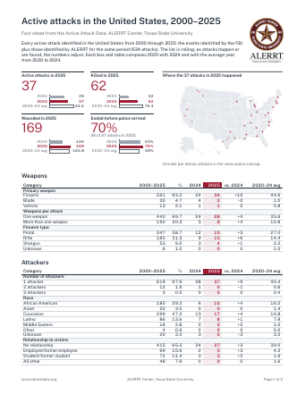{.fs-thumb alt="Page 1 of the fact sheet PDF"}

::: {.fs-download-text}
**Two-page PDF**

The same numbers, laid out for printing, briefings, and sharing.


:::
:::
:::

```{r}
fs_tiles_html(fs)
```
:::

## row 2 {height="auto"}

```{r}
#| title: Weapons
fs_table_html(fs, "Weapons")
```

```{r}
#| title: Attackers
fs_table_html(fs, "Attackers")
```

## row 3 {height="auto"}

```{r}
#| title: Locations
fs_table_html(fs, "Locations")
```

```{r}
#| title: How attacks ended
fs_table_html(fs, "Resolution")
```

## row 4 {height="auto"}

```{r}
#| title: Victims
fs_table_html(fs, "Victims")
```

::: {.card .flow title="Reading these numbers"}
**Columns.** The first column covers every attack in the data, with its
share of the total (firearm types are a share of firearm attacks). The
`{r} fs_yrs$curr` column is a count, and *vs. `{r} fs_yrs$prev`* is the change from the
year before (`{r} fs_yrs$prev` counts are in the PDF). Single years hold few attacks, so a change of a few
events is within normal year-to-year variation; the five-year average
gives the longer view.

**Definitions.** *One weapon* includes vehicle attacks and attacks with a firearm of unknown type. Race counts every attacker (unknown included), so its rows total the number of attackers, not attacks. *Shot by
civilian* includes off-duty officers and security guards. *Fled the
scene* includes a small number of attackers who fled after police
arrived. Victim counts follow ALERRT's definitions, which are stricter
than the FBI's (see *Download the Data*). Year-by-year figures always
come from the current version of the data, so attacks identified later
are counted in the year they happened.
:::

# Download the Data

## {height="auto"}

::: {.card .aa-head expandable="false"}
```{r}
#| echo: false
yrs <- range(aa_data$year, na.rm = TRUE)
fmt_size <- function(path) {
  kb <- file.size(path) / 1024
  if (kb < 1000) paste0(round(kb), " KB") else paste0(format(round(kb / 1024, 1), nsmall = 1), " MB")
}
csv_path <- glue("data/aa_data_wide_nogeo_{version}.csv")
cb_path  <- glue("data/aa_data_wide_codebook_{version}.docx")
tab_header("Download the data",
           "Every active attack in the United States since 2000, one row per attack, with its codebook. Free to download and use.",
           c("Attacks" = scales::comma(nrow(aa_data)), "Variables" = ncol(aa_data),
             "Years" = paste0(yrs[1], "–", yrs[2]), "Data version" = version))
```
:::

## row 1

### {width="62%"}

::: {.card .flow title="The data" expandable="false"}
::: {.aa-downloads}


[View the codebook online](codebook.html){.aa-text-link}
:::

```{r}
#| echo: false
datatable(aa_data,
          rownames = FALSE,
          filter   = "top",
          class    = "display nowrap",
          # Quarto dashboards switch paging off (bPaginate = FALSE in DT.options); this
          # card flows, so paging comes back on and the table stays 10 rows tall
          options  = list(bPaginate = TRUE, paging = TRUE, pageLength = 10,
                          lengthMenu = c(10, 25, 50, 100), scrollX = TRUE, autoWidth = FALSE,
                          dom = "lfrtip",
                          language = list(info = "Showing _START_ to _END_ of _TOTAL_ attacks",
                                          infoFiltered = "(filtered from _MAX_)",
                                          lengthMenu = "Show _MENU_ attacks",
                                          search = "Search:")))
```
:::

### {width="38%"}

::: {.card .flow .aa-notes title="About the data" expandable="false"}
The Research Ring at ALERRT makes the Active Attack Data freely available. Browse it here, or download the full dataset as a CSV file. The [codebook](codebook.html) lists every variable with its label, values, and missing counts, on its own page and as a PDF.

[One row per attack]{.aa-subhead}
Each of the `{r} format_num(nrow(aa_data))` rows is one active attack, from `{r} yrs[1]` through `{r} yrs[2]`. The `{r} ncol(aa_data)` variables cover when and where it happened, the attackers and their weapons, the people shot, wounded, and killed, and how it ended.

[Attacker variables]{.aa-subhead}
Because some attacks involved more than one attacker, age, sex, and race carry a suffix for each attacker (`age_1`, `age_2`, `age_3`). For an attack with one attacker, the `_2` and `_3` variables are empty. The order is arbitrary: attacker 1 was not more central to the attack than the others.

[Inclusive counts]{.aa-subhead}
Variables ending in `_incl` use the FBI's more inclusive definition. ALERRT counts only people shot, wounded, or killed by the attacker, so an injury suffered while fleeing is not in `wound_tot`. Where our figures differ from the FBI's annual reports, this is usually why.

[How attacks ended]{.aa-subhead}
`resolution` records how each attack ended, and `resolved_pre_le` whether that happened before law enforcement arrived. The few attackers who fled after police arrived are counted with those who fled before, since nearly all fleeing attackers leave before police reach the scene.

[Versions]{.aa-subhead}
Version `{r} version` was released `{r} format(version_released, "%B %e, %Y")`; the `relationship` coding was corrected `{r} format(version_corrected, "%B %e, %Y")`. Every change is listed under Updates on the [Home](index.html#updates) page. Earlier versions are kept for reproducing earlier work: [v2024 data](data/aa_data_wide_nogeo_2024.csv) and [codebook](data/aa_data_wide_codebook_2024.docx); [v2023 data](data/aa_data_wide_nogeo_2023.csv) and [codebook](data/aa_data_wide_codebook.docx).

[Using the data]{.aa-subhead}
Please cite the data when you use them. Suggested citation:

::: {.aa-cite}
```{r}
#| echo: false
knitr::asis_output(paste0("<p>", aa_citation(version, version_released)$html, "</p>"))
```
:::

A BibTeX entry is on the [codebook](codebook.html#suggested-citation) page. Questions and corrections: [Contact](3_contact.html).

[Related datasets]{.aa-subhead}
Two datasets built from these data, [K-12 door security](datasets.html#k-12-door-security) and [officers shot](datasets.html#officers-shot), are on the [More Data](datasets.html) page.
:::
